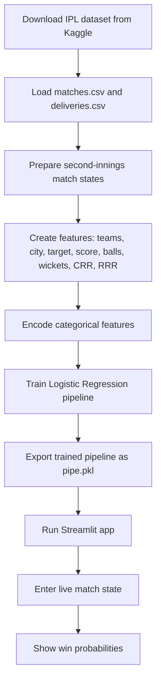

# IPL Win Probability Predictor

An interactive Streamlit application that estimates the probability of each team winning an Indian Premier League (IPL) match during the second innings.

## What this project does

Enter the chasing team, bowling team, host city, target, current score, completed overs, and wickets lost. The app uses a trained machine-learning pipeline to return the win probability for both teams.

## Data

The training notebook uses the [IPL Data Set on Kaggle](https://www.kaggle.com/datasets/ramjidoolla/ipl-data-set), specifically:

- `matches.csv` for match-level information such as teams, city, result, and winner.
- `deliveries.csv` for ball-by-ball innings information.

These CSV files are not included in this repository. Download them from Kaggle and place them beside `Untitled.ipynb` before running the notebook.

The extracted dataset may also include files such as `most_runs_average_strikerate.csv`, a Players spreadsheet, `teams.csv`, and `teamwise_home_and_away.csv`. They are not read by the current notebook or Streamlit app.

## Model and features

The trained model is a scikit-learn `Pipeline` containing:

1. A `ColumnTransformer` with one-hot encoding for the batting team, bowling team, and city.
2. A `LogisticRegression` classifier using the `liblinear` solver.

The notebook imports `RandomForestClassifier`, but the saved model and application use logistic regression.

The model uses these match-state features:

- Batting team and bowling team
- Host city
- Target score and runs remaining
- Balls remaining and wickets remaining
- Current run rate (CRR) and required run rate (RRR)

The saved notebook output reports an accuracy of approximately **80.31%** on its validation split. This is a historical notebook result, not a guarantee for future matches.

## Workflow



## Project files

- `Untitled.ipynb` - data preparation, feature engineering, training, evaluation, and model export.
- `app.py` - Streamlit interface that loads the trained model and predicts probabilities.
- `pipe.pkl` - trained model artifact expected by `app.py`. Generate it by running the notebook; it is not currently included in the repository.
- `requirements.txt` - Python dependencies.
- `Procfile` and `setup.sh` - deployment configuration for Streamlit.

## Run locally

1. Clone the repository and open its folder.
2. Create and activate a Python virtual environment (recommended).
3. Install dependencies:

   ```bash
   pip install -r requirements.txt
   ```

4. Download `matches.csv` and `deliveries.csv` from the Kaggle dataset and place both files in the project folder.
5. Run all cells in `Untitled.ipynb` to train the model and create `pipe.pkl`.
6. Start the app:

   ```bash
   streamlit run app.py
   ```

## Notes

- The app is designed for IPL second-innings chases.
- Predictions are estimates based on historical IPL data and the model's training setup.
- Ensure `pipe.pkl` is present before starting the Streamlit app; otherwise `app.py` cannot load the model.
